# HR Policy Bot

**Problem Statement option: 6, HR Policy Bot.** Upload employee handbooks; answer leave, benefits and conduct-policy
questions with page citations.

| | |
|---|---|
| **Live app** | `https://<your-project>.vercel.app` (frontend on Vercel) |
| **API** | `https://<your-workspace>--hr-policy-bot.modal.run` (backend on Modal; interactive docs at `/docs`) |
| **Repository** | https://github.com/milindkumarmk18-blip/HR-RAG-Pipeline |
| **Submission** | Option A, hosted link plus repo |

Ask a question about an employee handbook and get an answer that cites the exact section and page it came from.
Clicking a citation opens the PDF at that page with the passage highlighted beside it, so every claim can be checked.

This is the Phase 1 (RAG Foundations) project of the AI Engineering Masters Program. It is architecturally equivalent
to the reference project ([waseemkhan606/Single-Source-Retrieval](https://github.com/waseemkhan606/Single-Source-Retrieval))
in a different domain:

**PDF upload → section-aware chunking → local embeddings → FAISS → query routing (lookup / multi-part / summary) →
cross-encoder re-ranking → LCEL chain → Gemini answer with citations → RAGAS scores logged to JSONL for every query.**

> The hosted backend scales to zero when idle. The first visit after a quiet spell takes 20–60 seconds while the
> server starts; the page shows "Starting the server" and connects on its own.

---

## Contents

- [What is live and what isn't](#what-is-live-and-what-isnt)
- [Documents](#documents)
- [Features](#features)
- [Architecture](#architecture)
- [Tech stack](#tech-stack)
- [Run it locally (Windows, about 10 minutes)](#run-it-locally-windows-about-10-minutes)
- [Step-by-step guide checklist: evidence](#step-by-step-guide-checklist-evidence)
- [Re-ranking: before vs after](#re-ranking-before-vs-after)
- [RAGAS evaluation](#ragas-evaluation)
- [API reference](#api-reference)
- [Deployment (GitHub, Modal, Vercel)](#deployment-github-modal-vercel)
- [Configuration](#configuration)
- [Project structure](#project-structure)
- [Testing](#testing)
- [Design decisions and limitations](#design-decisions-and-limitations)

---

## What is live and what isn't

Everything in the running app is real; nothing is mocked.

| Part | Status |
|---|---|
| Embeddings (`BAAI/bge-small-en-v1.5`), FAISS search, cross-encoder re-ranking (`ms-marco-MiniLM-L-6-v2`) | Live, run locally on the server's CPU |
| Query router / decomposer, answer generation, RAGAS judge | Live Gemini calls (`gemini-3.5-flash-lite`) |
| RAGAS scores in the UI and in `ragas_eval.jsonl` | Live: the RAGAS library scoring each real answer against the exact passages the model received |
| Rule-based router | A **fallback**, used only when the Gemini routing call fails or no key is set. The UI says "Planned by the rule-based fallback" when it is used |
| Passages-only mode | Used only when no `GOOGLE_API_KEY` is configured, or when the user ticks "Show passages only"; the UI says so |
| Test suite (`backend/tests`) | Uses **stand-in** models (hashing embedder, word-overlap re-ranker, fake Gemini) so it runs offline. These are never used by the app |
| Re-rank and golden-set tables below | Produced by `eval/compare_rerank.py` and `eval/run_golden.py`, which write them into this README with the run date |

Known limits are listed under [Design decisions and limitations](#design-decisions-and-limitations).

## Documents

Every PDF in `backend/data/sample/` is indexed on first start (you can remove them in the app and upload your own):

| File | What it is | Why it's included |
|---|---|---|
| `Lumora_Employee_Handbook_2026.pdf` (17 pages) | A **synthetic** handbook for a fictional Indian company, written for this project | Covers every policy area (leave, benefits, pay, hybrid work, travel, conduct, POSH, discipline, IT, resignation) with specific, checkable numbers; the golden set's reference answers are written against it |

**Real document (to add):** the step-by-step guide asks for real PDFs. A suitable public-domain one is the US Office
of Personnel Management's
[Handbook on Leave and Workplace Flexibilities for Childbirth, Adoption, and Foster Care (January 2025)](https://www.opm.gov/chcoc/transmittals/2025/Rev%20CPM%202025-04%20Handbook%20on%20Flexibilities%20for%20Childbirth%20Adoption%20and%20Foster%20Care.pdf),
about 140 pages with Roman-numeral chapters and lettered sections, which the chunker handles. Save it into
`backend/data/sample/` to bundle it, or upload it in the app.

Uploads accept any text-based PDF (up to 8 documents in total, 25 MB each).

## Features

- **Upload handbooks**: drag in PDFs. Each is cleaned (running headers, footers and table-of-contents lines removed,
  wrapped lines re-joined), split inside section boundaries, embedded locally and added to FAISS. The chunk list is
  printed to the server console. Re-uploading the same file is detected by hash.
- **Grounded, cited answers**: every factual sentence carries a citation such as `§3.4`. Hovering a citation
  highlights its passage in the margin; clicking opens the PDF at that page next to the highlighted excerpt.
  Questions the handbook doesn't answer get "I couldn't find this in the uploaded handbook" plus who to ask.
- **Query routing**: one Gemini structured-output call classifies each message as `policy_lookup`, `multi_part`,
  `summary`, `chitchat` or `out_of_scope`, rewrites follow-ups into standalone questions ("what about interns?"), and
  splits multi-part questions into 2–4 sub-questions.
- **Per-route retrieval**: lookups keep the 4 best chunks; multi-part questions are retrieved and re-ranked per
  sub-question (3 each) and interleaved; summaries search wider (24 candidates), keep up to 10 chunks and put them back
  in handbook order.
- **Retrieval inspector**: under each answer, a slope chart and a table show each candidate's FAISS rank, cosine
  score, re-ranked position and relevance.
- **RAGAS per query**: faithfulness, answer relevancy and context precision are scored in the background, shown under
  the answer when ready, and appended to `ragas_eval.jsonl`. The Evaluation log tab lists every query with averages and
  a JSONL download.
- **Streaming** over server-sent events (plan, then sources, then tokens), **voice input** where the browser supports
  the Web Speech API, light and dark themes, keyboard access, phone-width layout.

## Architecture



**Hosting.** The Next.js UI is a static export on Vercel. It calls the FastAPI backend on Modal, which runs as one
container (so uploads, the FAISS index and the RAGAS worker share one process) with a persistent volume for the index,
uploaded PDFs and the JSONL log. Locally, FastAPI serves both the API and the built UI on one port.

**Request flow.** The browser posts the question and the last three turns to `/api/chat/stream`. The LCEL `prepare`
chain runs three `RunnablePassthrough.assign` steps: `plan` (router), `retrieval` (FAISS then cross-encoder, per
sub-question, in a worker thread) and `prompt_inputs` (numbered `<source>` blocks with page and section). The server
streams a `plan` event, a `retrieval` event with every source, then the tokens of
`ANSWER_PROMPT | ChatGoogleGenerativeAI | StrOutputParser`, then `done`. Before `done`, citations to sources that
don't exist are removed and each source is marked cited or not. The answer is then queued for RAGAS, which scores one
query at a time and waits while a chat request is in flight, so scoring never delays an answer.

**Ingestion.** `PyPDFLoader` extracts each page. Lines that repeat at the top or bottom of most pages (headers,
footers, page numbers) and table-of-contents lines are dropped, and PDF line wraps are re-joined. Headings are
detected in three styles: numbered (`3.4 Sick Leave`), Roman/lettered (`II. Pregnancy and Childbirth`, `A. Sick
Leave`, labelled `II.A Sick Leave`) and ALL CAPS. Each section is split separately with
`RecursiveCharacterTextSplitter` (1,000 characters, 150 overlap), so a chunk never mixes two policies. Each chunk
records source file, page range (1-based, as a PDF viewer numbers pages), chunk index, chapter, section and a topic
category, and is embedded with its section path as a header (`[3. Leave Policy > 3.4 Sick Leave]`). A PDF without
detectable headings falls back to page-by-page splitting.

<details>
<summary>Mermaid source of the diagram</summary>

See [docs/architecture.mmd](docs/architecture.mmd).
</details>

## Tech stack

| Layer | Choice | Why |
|---|---|---|
| Frontend | Next.js 16 (static export), React 19, TypeScript | Same framework as the reference; static output deploys to Vercel or is served by FastAPI |
| Backend | FastAPI + Uvicorn, server-sent events | Async API with streaming; OpenAPI docs at `/docs` |
| Orchestration | LangChain 1.x, LCEL runnables | `RunnablePassthrough.assign` steps, prompt templates, structured output, fallbacks |
| LLM | Gemini `gemini-3.5-flash-lite` via `langchain-google-genai` | Fast and inexpensive; `GEMINI_MODEL` changes it |
| Embeddings | `BAAI/bge-small-en-v1.5` (sentence-transformers, CPU) | Local and free like the guide's `all-MiniLM-L6-v2`, with stronger retrieval scores for its size; `EMBEDDING_MODEL=sentence-transformers/all-MiniLM-L6-v2` switches |
| Vector store | FAISS (`IndexFlatIP` on L2-normalised vectors) via LangChain | Exact cosine search, persisted to disk |
| Re-ranker | `cross-encoder/ms-marco-MiniLM-L-6-v2` | The cross-encoder the guide suggests |
| PDF parsing | `pypdf` through `PyPDFLoader` | Reliable page boundaries for citations |
| Evaluation | RAGAS 0.4.3, Gemini judge, local embeddings | Faithfulness, answer relevancy, context precision per query; context recall and reference-based precision on the golden set |
| Rate limiting | LangChain `InMemoryRateLimiter`, shared by all Gemini calls | Stays under free-tier limits (about 15 requests/minute) |
| Hosting | Vercel (frontend), Modal (backend), GitHub Actions (CI, optional auto-deploy) | See [Deployment](#deployment-github-modal-vercel) |

## Run it locally (Windows, about 10 minutes)

Needs **Python 3.10–3.13** and **Git**. **Node.js 20+** is only needed to rebuild the UI
(`winget install OpenJS.NodeJS.LTS`); a Gemini key from [Google AI Studio](https://aistudio.google.com/apikey) turns
on answers and RAGAS (without one, the app runs in passages-only mode).

```powershell
git clone https://github.com/milindkumarmk18-blip/HR-RAG-Pipeline.git
cd HR-RAG-Pipeline
powershell -ExecutionPolicy Bypass -File .\setup.ps1     # venv, packages, backend\.env, UI build if Node is present
notepad backend\.env                                     # set GOOGLE_API_KEY=...
powershell -ExecutionPolicy Bypass -File .\start.ps1     # http://localhost:8000
```

The first start downloads the two local models (about 200 MB) and indexes the bundled handbooks, which takes a minute
or two; later starts load the saved index. Check it end to end with
`.\.venv\Scripts\python.exe backend\scripts\smoke_test.py` while the server is running.

<details>
<summary>macOS / Linux, manual steps, and UI development mode</summary>

```bash
python3 -m venv .venv && source .venv/bin/activate
pip install -r backend/requirements-dev.txt
cp backend/.env.example backend/.env            # set GOOGLE_API_KEY
(cd frontend && npm install && npm run build)   # optional if you only need the API
cd backend && uvicorn app.main:app --reload --reload-dir app --port 8000
```

UI with hot reload: keep the backend running, then `cd frontend && npm run dev` and open http://localhost:3000.
</details>

## Step-by-step guide checklist: evidence

| Step | Checklist item | How to verify |
|---|---|---|
| 1. Domain and scope | Domain chosen, real PDFs | Option 6 (top of this file). Documents: see [Documents](#documents). In scope: leave, holidays, benefits, pay, working arrangements, travel, conduct, harassment, discipline, separation. Out of scope: legal advice, decisions about individual cases, anything outside the uploaded documents |
| 2. Scaffold | `backend/` + `frontend/`, `.env.example`, pinned requirements, `/health` returns 200 | `GET /health`; `backend/.env.example`, `frontend/.env.example`; `backend/requirements.txt` |
| 3. Ingestion | Upload produces chunks with correct pages, printed to console | Upload a PDF and watch the server console, or run `python backend/scripts/inspect_chunks.py <pdf>`. Metadata per chunk: source, page, page_end, chunk_index, chapter, section, category |
| 4. Embeddings + FAISS | Persisted index; same question gives identical top-k; different questions differ | `python backend/scripts/query_index.py "How many sick days do I get?"` (run twice, then with another question); test `test_query_index_is_deterministic_and_question_specific`; index files in `backend/data/index/` |
| 5. LCEL chain | Grounded answers; honest "not in this document" | Ask "Does the company offer a car lease scheme?"; the response JSON has `answer` plus `sources` (id, page, section, text) |
| 6. Routing / decomposition | Multi-part question shows retrieval for both parts | Ask "Can I carry forward casual leave, and what is the notice period at level L3?": the answer shows the sub-questions, and "How this answer was found" lists a ranking per sub-question. Summary route: "Give me an overview of the leave policy" |
| 7. Re-ranking | Pre- and post-rerank order logged; a query where the top result changes | [Before vs after](#re-ranking-before-vs-after) table and its "top result changed" list; the slope chart under every answer; `retrieval.per_sub_question[].faiss_order` / `final_order` in each JSONL line |
| 8. RAGAS | Labelled eval set; per-query metrics in JSONL; script runs end to end | `backend/eval/golden_set.jsonl` (26 questions); `python backend/eval/run_golden.py`; live log `backend/data/logs/ragas_eval.jsonl` (format below) |
| 9. Frontend | Upload box, question box, answer, sources with pages | The live app: sidebar upload, composer, margin notes, PDF drawer |
| 10. README + deploy | Setup, architecture, tech stack, API reference, deployed link re-tested | This file; the live links at the top |

## Re-ranking: before vs after

`python eval/compare_rerank.py` (from `backend/`, no API key needed) takes each golden question (multi-part ones split
into their sub-questions), ranks the same 12 FAISS candidates two ways, and records where the first chunk from the
correct handbook section lands. It rewrites the block below and saves
[docs/rerank_comparison.md](docs/rerank_comparison.md).

<!-- BEGIN:rerank -->
_Not generated yet. Run `python eval/compare_rerank.py` from `backend/` to fill in this table._
<!-- END:rerank -->

**hit@1** is the share of questions whose correct section ranks first, **hit@3** the share in the top three, **MRR**
the mean of 1/rank, and **recall@12** the share where FAISS found the section at all (the same for both orderings,
since re-ranking only reorders FAISS's candidates).

## RAGAS evaluation

**Per query (live).** Live questions have no reference answer, so each answer is scored with reference-free metrics:

| Metric | RAGAS class | A low score means |
|---|---|---|
| Faithfulness | `Faithfulness` | The answer says things the retrieved passages don't support |
| Answer relevancy | `ResponseRelevancy` (strictness 3, local embeddings) | The answer drifts from the question or is evasive |
| Context precision | `LLMContextPrecisionWithoutReference` | Useful passages were ranked below useless ones |

**Log format.** `backend/data/logs/ragas_eval.jsonl`, one line per query. The first keys mirror the reference
project's log; the rest is extra detail:

```json
{
  "timestamp": "2026-10-25T15:20:41+00:00",
  "query_id": "3f2a9c1d0b7e",
  "question": "How many sick days do I get, and when do I need a medical certificate?",
  "answer_preview": "You get 10 working days of sick leave each year [S1]. A medical certificate is required for…",
  "metrics": { "faithfulness": 0.92, "answer_relevancy": 0.88, "context_precision": 0.85, "context_recall": null },
  "standalone_question": "…", "route": "policy_lookup", "planner": "llm", "sub_questions": ["…"],
  "mode": "rag", "answer": "…",
  "contexts": [{ "id": "S1", "chunk_id": "…", "source": "…pdf", "page": 4, "section": "3.4 Sick Leave", "cited": true, "text": "…" }],
  "retrieval": { "reranked": true, "per_sub_question": [{ "question": "…", "faiss_order": ["…"], "final_order": ["…"], "selected": ["…"] }] },
  "eval_status": "complete", "eval_error": null, "eval_ms": 41250,
  "timings": { "route_ms": 640, "retrieve_ms": 85, "generate_ms": 910, "total_ms": 1650 },
  "models": { "llm": "gemini-3.5-flash-lite", "judge": "gemini-3.5-flash-lite", "embedding": "BAAI/bge-small-en-v1.5", "reranker": "cross-encoder/ms-marco-MiniLM-L-6-v2" }
}
```

(The values above are illustrative.) `context_recall` is `null` for live queries because it needs a reference answer.
Greetings and off-topic messages are logged with `eval_status: "skipped"`. Citation markers are stripped before
scoring.

**Golden set (offline).** [`backend/eval/golden_set.jsonl`](backend/eval/golden_set.jsonl) has 26 questions with
reference answers and gold sections and pages: 20 single-section lookups, 3 multi-part questions, 1 summary and 2
questions the handbook can't answer (to check the bot declines).

```bash
cd backend
python eval/run_golden.py --limit 5     # quick check
python eval/run_golden.py               # all of it; about 25-30 minutes on a free-tier key
python eval/run_golden.py --no-rerank   # same questions in FAISS order, for comparison
```

It adds `LLMContextRecall` and `LLMContextPrecisionWithReference`, gold-section recall, whether the answer cites a gold
page, and correct refusals. It writes `eval/results/golden_<timestamp>_<variant>.jsonl` (same leading keys as the live
log) and a summary that replaces the block below.

<!-- BEGIN:golden -->
_Not generated yet. Run `python eval/run_golden.py` from `backend/` after setting `GOOGLE_API_KEY`._
<!-- END:golden -->

Scores aren't all 1.0 because the judge is a separate LLM call that breaks the answer into claims and checks each one
against the passages: paraphrases, partial answers and refusals score lower, and answer relevancy is near 0 for
refusals by design. The contexts scored are exactly the ones the model received; they are not retrieved again for
evaluation.

## API reference

Base URL: `http://localhost:8000` locally, or the Modal URL. Interactive docs: `/docs`.

| Method | Path | Purpose |
|---|---|---|
| `GET` | `/health` | Liveness check, `{"status": "ok"}` |
| `GET` | `/api/health` | Models in use, whether a key is set, document and chunk counts, eval queue length |
| `GET` | `/api/documents` | Indexed documents |
| `POST` | `/api/documents` | Upload PDFs (`multipart/form-data`, field `files`, repeatable) |
| `POST` | `/api/documents/sample` | Re-index the bundled handbooks |
| `DELETE` | `/api/documents/{doc_id}` | Remove one document and its vectors |
| `DELETE` | `/api/documents` | Remove everything |
| `GET` | `/api/documents/{doc_id}/file` | The PDF itself (append `#page=N` in a browser) |
| `GET` | `/api/documents/{doc_id}/chunks?page=N` | The stored chunks for a document, optionally one page |
| `POST` | `/api/chat` | Ask a question; returns the full result as JSON |
| `POST` | `/api/chat/stream` | Same, streamed as server-sent events |
| `GET` | `/api/evals?limit=50` | Recent query records plus averages |
| `GET` | `/api/evals/{query_id}` | Evaluation status and scores for one query |
| `POST` | `/api/evals/{query_id}/retry` | Re-run RAGAS for a failed or partial evaluation |
| `GET` | `/api/evals/export` | Download `ragas_eval.jsonl` |

**`POST /api/chat`** request:

```json
{
  "question": "How many sick days do I get, and when do I need a medical certificate?",
  "history": [{ "role": "user", "content": "..." }, { "role": "assistant", "content": "..." }],
  "options": { "rerank": true, "top_n": null, "evaluate": true, "retrieval_only": false }
}
```

Response (abridged; the values are illustrative):

```json
{
  "query_id": "3f2a9c1d0b7e",
  "question": "How many sick days do I get, and when do I need a medical certificate?",
  "answer": "You get 10 working days of sick leave each year [S1]. A medical certificate is required for sick leave of more than 2 consecutive working days [S1].",
  "mode": "rag",
  "plan": {
    "route": "policy_lookup",
    "standalone_question": "How many sick leave days do employees get, and when is a medical certificate required?",
    "sub_questions": ["How many sick leave days do employees get, and when is a medical certificate required?"],
    "topic": "Leave",
    "planner": "llm"
  },
  "sources": [
    {
      "id": "S1", "chunk_id": "9c1e2f…:0013", "doc_id": "9c1e2f…", "source": "Lumora_Employee_Handbook_2026.pdf",
      "page": 4, "page_end": 4, "chapter": "3. Leave Policy", "section": "3.4 Sick Leave", "category": "Leave",
      "text": "3.4 Sick Leave\nYou receive 10 working days of sick leave (SL) each year…",
      "faiss_rank": 2, "faiss_score": 0.8123, "rerank_rank": 1, "rerank_score": 7.41, "relevance": 0.9994,
      "selected": true, "cited": true
    }
  ],
  "retrieval": {
    "reranked": true, "fetch_k": 12,
    "sub_queries": [{ "question": "…", "candidates": [{ "chunk_id": "…", "section": "3.4 Sick Leave", "page": 4,
      "faiss_rank": 2, "faiss_score": 0.8123, "rerank_rank": 1, "rerank_score": 7.41, "relevance": 0.9994,
      "selected": true, "preview": "…" }] }]
  },
  "timings": { "route_ms": 640, "retrieve_ms": 85, "generate_ms": 910, "total_ms": 1650 },
  "models": { "llm": "gemini-3.5-flash-lite", "embedding": "BAAI/bge-small-en-v1.5",
              "reranker": "cross-encoder/ms-marco-MiniLM-L-6-v2", "prompt_version": "2026-10-25.2" },
  "eval": { "query_id": "3f2a9c1d0b7e", "eval_status": "queued", "scores": null, "eval_error": null, "eval_ms": null }
}
```

`plan.route` is `policy_lookup`, `multi_part`, `summary`, `chitchat` or `out_of_scope`. `mode` is `rag` (answered),
`direct` (greeting or off-topic; no retrieval), `retrieval_only` (no key, or `retrieval_only: true`) or
`no_documents`. `faiss_score` is cosine similarity; `rerank_score` is the cross-encoder logit and `relevance` its
sigmoid.

**`POST /api/chat/stream`** sends these events, in order: `plan` (`{query_id, mode, plan}`), `retrieval`
(`{sources, retrieval}`, sources not yet marked cited), `token` (`{text}`, repeated), `done` (the full `/api/chat`
response), or `error` (`{message}`, e.g. rate limit reached or invalid key).

**`GET /api/evals/{query_id}`**: `eval_status` is `queued`, `running`, `complete`, `partial` (some metrics failed),
`failed` or `skipped`; `scores` has `faithfulness`, `answer_relevancy` and `context_precision` (0–1, or `null`).

## Deployment (GitHub, Modal, Vercel)

The frontend goes on **Vercel** and the backend on **Modal**. The backend can't run as Vercel functions: it needs one
long-lived process that keeps the FAISS index and uploaded PDFs between requests and scores answers in the background,
while Vercel functions are stateless instances, so a PDF indexed by one would be missing on the next. Modal runs the
same FastAPI app as a single container with a persistent volume, scales it to zero when idle, and its free Starter plan
includes $30/month of compute (a warm container costs about $0.07/hour).

### 1. Push to GitHub

From the project folder (Git for Windows; `gh` is not needed):

```powershell
git init -b main
git add .
git status                      # backend/.env, .venv and node_modules must NOT be listed
git commit -m "HR Policy Bot: Phase 1 RAG assistant"
git remote add origin https://github.com/milindkumarmk18-blip/HR-RAG-Pipeline.git
git push -u origin main
```

If the GitHub repo already has a commit (for example a README created on github.com), run
`git pull origin main --allow-unrelated-histories` before pushing, and keep this project's files if there is a
conflict. Git asks you to sign in through the browser the first time.

### 2. Backend on Modal

1. Sign up at [modal.com](https://modal.com) with your GitHub account.
2. In the project's virtual environment:
   ```powershell
   .\.venv\Scripts\Activate.ps1
   pip install modal
   modal setup                                                  # opens the browser to log in
   modal secret create hr-policy-bot GOOGLE_API_KEY=your-key    # the Gemini key, stored by Modal, not in git
   modal deploy backend/modal_app.py
   ```
3. The first deploy builds the image (installs torch and downloads both models), which takes several minutes. It prints
   the URL, `https://<your-workspace>--hr-policy-bot.modal.run`. Open `<that URL>/api/health` to check it.

To redeploy automatically on every push, add repository secrets `MODAL_TOKEN_ID` and `MODAL_TOKEN_SECRET` (create a
token at modal.com → Settings → API Tokens); `.github/workflows/deploy-backend.yml` then runs `modal deploy` for you.

### 3. Frontend on Vercel

1. At [vercel.com](https://vercel.com), sign in with GitHub → **Add New → Project** → import `HR-RAG-Pipeline`.
2. Set **Root Directory** to `frontend` (Vercel detects Next.js).
3. Under **Environment Variables**, add `NEXT_PUBLIC_API_BASE` = your Modal URL (no trailing slash).
4. **Deploy**. Every later push to `main` redeploys automatically.

The backend accepts browser requests from any `*.vercel.app` origin (`CORS_ORIGIN_REGEX`). For a custom domain, add it
to `CORS_ORIGINS` in the Modal secret and redeploy.

### 4. Before submitting

Open the Vercel URL in an **incognito window**, wait for it to connect, upload a PDF, ask a question, open a citation,
and check that RAGAS scores appear under the answer. Then put both URLs in the table at the top of this README.

**Other hosts.** The `Dockerfile` builds the UI and the API into one image that runs on any Docker host with at least
2 GB of RAM (`docker build -t hr-policy-bot .` then `docker run -p 7860:7860 -e GOOGLE_API_KEY=... hr-policy-bot`).
Hugging Face Docker Spaces now require a paid plan.

## Configuration

Environment variables, read from `backend/.env` locally (see [backend/.env.example](backend/.env.example)) or from the
Modal secret when deployed.

| Variable | Default | Meaning |
|---|---|---|
| `GOOGLE_API_KEY` | (none) | Gemini key. Without it: passages-only mode, rule-based router, no RAGAS |
| `GEMINI_MODEL` / `JUDGE_MODEL` | `gemini-3.5-flash-lite` | Answer and router model, and the RAGAS judge (`python backend/scripts/list_models.py` lists yours) |
| `GEMINI_RPM` | `14` | Requests per minute shared by every Gemini call |
| `EMBEDDING_MODEL` | `BAAI/bge-small-en-v1.5` | Changing it re-indexes the stored PDFs on next start |
| `RERANKER_MODEL` | `cross-encoder/ms-marco-MiniLM-L-6-v2` | Any sentence-transformers cross-encoder |
| `CHUNK_SIZE` / `CHUNK_OVERLAP` | `1000` / `150` | Characters (about 250 / 40 tokens) |
| `FETCH_K` | `12` | FAISS candidates per (sub-)question |
| `TOP_N` / `TOP_N_PER_SUBQUESTION` | `4` / `3` | Chunks kept after re-ranking |
| `SUMMARY_FETCH_K` / `SUMMARY_CHUNKS` | `24` / `10` | Candidates and chunks for summary requests |
| `MAX_CONTEXT_CHUNKS` | `8` | Cap on chunks sent to the model (multi-part questions) |
| `MIN_RELEVANCE` | `0.01` | Drop re-ranked chunks below this probability (the best one is always kept) |
| `EVAL_ENABLED` | `true` | Background RAGAS per query |
| `DATA_DIR` / `SAMPLE_DIR` | `backend/data` / `backend/data/sample` | Runtime state (index, uploads, logs) / handbooks indexed on first start |
| `AUTOLOAD_SAMPLE` | `true` | Index the bundled handbooks when the index is empty |
| `MAX_UPLOAD_MB` / `MAX_DOCUMENTS` | `25` / `8` | Upload limits |
| `CORS_ORIGINS` / `CORS_ORIGIN_REGEX` | localhost:3000 / `https://[a-z0-9-]+\.vercel\.app` | Browser origins allowed to call the API |

The frontend reads one variable, `NEXT_PUBLIC_API_BASE`: the backend URL. Leave it empty when FastAPI serves the UI;
never put keys in `NEXT_PUBLIC_` variables, because they are shipped to the browser.

## Project structure

```
├── backend
│   ├── app
│   │   ├── main.py          FastAPI routes, SSE streaming, serves the built UI
│   │   ├── config.py        Settings (environment / .env)
│   │   ├── state.py         Builds models, index, pipeline and evaluator at startup
│   │   ├── ingest.py        PDF loading, cleaning, heading detection, section-aware chunking
│   │   ├── vectorstore.py   Local embeddings, FAISS persistence, query_index, document registry
│   │   ├── router.py        QueryPlan schema, LLM router with rule-based fallback
│   │   ├── retrieval.py     FAISS top-k, cross-encoder re-ranking, summary retrieval, context formatting
│   │   ├── reranker.py      Cross-encoder wrapper
│   │   ├── prompts.py       Router and answer prompts (versioned)
│   │   ├── chain.py         LCEL pipeline, streaming, citation validation
│   │   ├── evaluation.py    RAGAS scorer, background queue, JSONL log
│   │   ├── llm.py           Gemini factory, shared rate limiter, chat priority
│   │   └── schemas.py       Request models
│   ├── data/sample          Bundled handbooks
│   ├── eval                 golden_set.jsonl, compare_rerank.py, run_golden.py
│   ├── scripts              inspect_chunks.py, query_index.py, smoke_test.py, list_models.py,
│   │                        prefetch_models.py, make_sample_handbook.py
│   ├── tests                pytest suite with offline stand-in models
│   ├── modal_app.py         Modal deployment
│   ├── requirements.txt / requirements-dev.txt / .env.example
├── frontend
│   ├── app                  layout, page, globals.css
│   ├── components           Sidebar, ExchangeView, RetrievalInspector, Scores, PdfDrawer, Composer, EvalLog
│   ├── lib                  API client (fetch + SSE), types, formatting
│   └── .env.example
├── .github/workflows        ci.yml (tests + UI build), deploy-backend.yml (optional Modal deploy)
├── docs                     architecture diagram, re-rank comparison
├── Dockerfile               single-image alternative to Modal + Vercel
├── setup.ps1 / start.ps1    Windows setup and start
└── .env.example
```

## Testing

```bash
cd backend
pytest -q
```

The suite runs offline in a few seconds and in CI on every push. It swaps in a hashing embedder, a word-overlap
re-ranker and a fake Gemini model (which answers router, answer and RAGAS judge prompts). It covers chunking (pages,
sections, numbered, Roman and lettered headings, header and table-of-contents removal, line reflow), deterministic and
question-specific retrieval, routing, decomposition and summaries, re-rank bookkeeping, multi-part context coverage,
citation validation, streaming, the RAGAS plumbing, the background evaluation worker and the JSONL format, and the
upload, delete and passages-only API paths. It does not call the real models; the live app and the evaluation
scripts do.

## Design decisions and limitations

- **Section-aware chunking over fixed windows.** Handbook policies are short numbered sections (30–210 words in the
  sample), so chunks stay inside a section and the section title becomes the citation. That makes most chunks smaller
  than the guide's 500–800-token starting point; `CHUNK_SIZE` only matters for long sections.
- **One routing call.** Route, standalone rewrite and sub-questions come from one structured-output call, so routing
  adds one fast request. If it fails, rules take over.
- **Re-ranking per sub-question.** Each part of a multi-part question competes only with its own candidates, and the
  context interleaves the best chunks for each part, so one part can't crowd out the other.
- **Summaries in document order.** Summary requests keep more chunks and reorder them as the handbook does, so the
  summary follows its structure.
- **Shared rate limiter and chat priority.** Answers, routing and RAGAS share one bucket; the evaluator waits while a
  chat request is in flight. On a free-tier key, RAGAS scores appear about a minute after the answer.
- **The same model generates and judges** by default. Set `JUDGE_MODEL` to a different Gemini model to reduce
  self-preference bias.
- **RAGAS legacy metric classes.** RAGAS 0.4's newer metric API routes Gemini through Instructor, which has a known
  safety-settings bug with the Gemini API. The LangChain-wrapped classes reuse the app's Gemini client and work in
  0.4.3 (with deprecation warnings). `langchain-community` is pinned to 0.4.1 because RAGAS 0.4.3 imports a module that
  0.4.2 removed.
- **Limitations.** Scanned (image-only) PDFs need OCR first. Tables are extracted cell by cell, which works for lookups
  but loses layout. Heading styles other than numbered, Roman/lettered or ALL CAPS fall back to page-based chunks.
  Hosted cold starts take 20–60 seconds. Answers are informational: the handbook and HR remain the authority.
- **Out of scope for Phase 1**, as the brief specifies: hybrid search, GraphRAG, multi-agent orchestration,
  production observability and caching.

The Lumora handbook describes a fictional company; its names, figures and e-mail addresses are invented.
